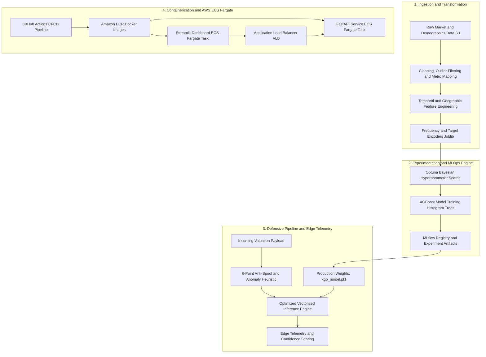

# EstatePulse AI 🏠

[](https://www.python.org/)
[](https://fastapi.tiangolo.com/)
[](https://streamlit.io/)
[](https://xgboost.readthedocs.io/)
[](https://mlflow.org/)
[](https://www.docker.com/)
[](https://aws.amazon.com/ecs/)
[](LICENSE)
[](https://github.com/anuraggurjar01)

> **Enterprise-Grade Real Estate Valuation Platform & Automated MLOps Pipeline**  
> Architected and engineered by **[Anurag Gurjar](https://github.com/anuraggurjar01)**. Featuring real-time anti-spoofing heuristics, sub-15ms edge inference, MLflow experiment tracking, dual containerized microservices, and serverless AWS ECS Fargate autoscaling.

---

## 📋 Executive Overview

**EstatePulse AI** is a production-hardened machine learning platform engineered to solve multi-metro real estate appraisal and price forecasting. Unlike traditional static regression scripts, EstatePulse AI implements end-to-end MLOps lifecycle standards:

- **Robust Data Pipeline**: Temporal train/validation/test holdout splitting, geographical normalization across major US metropolitan statistical areas (MSAs), outlier bounds, and leak-free target & frequency encoding.
- **Gradient Boosted Intelligence**: Optimized XGBoost regressor fine-tuned via Optuna Bayesian search, tracking hyperparameter loss trajectories and model artifacts through MLflow.
- **Defensive Anti-Spoofing & Input Heuristics**: An in-line 6-point verification engine detecting synthetic anomalies, out-of-bounds metrics, and data drift before inference.
- **Edge Telemetry Engine**: Live operational diagnostics exposing latency SLAs, process memory footprint, model signatures, and schema compliance.
- **Cloud-Native Microservices**: Decoupled FastAPI REST service and Streamlit interactive web application containerized with multi-stage Docker builds and orchestrated on AWS ECS Fargate.

---

## 🏗️ System Architecture

The following diagram illustrates the complete end-to-end topology from raw ingestion to serverless cloud orchestration:



---

## 🛡️ Key Innovations & Technical Highlights

### 1. In-Line Anti-Spoofing & Out-of-Distribution Heuristics
Tabular models in production are susceptible to malformed records, out-of-distribution inputs, and synthetic adversarial anomalies. EstatePulse AI implements a dedicated pre-scoring heuristic engine that evaluates:
- **Price Plausibility Boundary**: Intercepts negative valuations and ungrounded spikes (> $50M).
- **Square Footage & PPSF Sanity**: Enforces realistic price-per-square-foot ratios ($5 to $15,000).
- **Market Dynamics Ratio**: Detects synthetic distortion in sale-to-list multipliers (< 0.4 or > 2.5).
- **Geographic Consistency**: Verifies boundary constraints across Continental US metropolitan coordinates.
- **Inventory & Velocity Non-Negativity**: Guards against corrupt inventory, pending sales, and negative days on market.
- **Real-Time Confidence Scoring**: Generates a dynamic `confidence_score` (20% – 99.5%) and `anomaly_status` badge attached to every inference response.

### 2. Edge Telemetry & Diagnostics API
The `/telemetry` endpoint provides production telemetry for real-time observability:
- **Inference SLA Monitoring**: Rolling average latency (target: sub-15ms).
- **Anomaly Interception Counter**: Real-time counter of suspicious or OOD submissions.
- **Runtime Footprint**: Process resident set size (RSS) memory consumption and system uptime.
- **Schema Alignment**: Expected feature dimension verification and model timestamp integrity.

### 3. Decoupled Cloud Microservices
- **FastAPI Core**: Lightweight ASGI backend serving low-latency REST predictions, health checks, and batch valuations.
- **Streamlit Interactive Frontend**: Feature-rich dashboard providing portfolio historical exploration, real-time single-property valuation simulator, and architecture diagnostics.

---

## 📸 Platform Previews & Visualizations

FastAPI OpenAPI Interactive Documentation:


Streamlit Analytics & Valuation Interface:


MLflow Experiment Tracking & Model Registry:


---

## 🛠️ Complete Tech Stack

| Category | Technologies |
| :--- | :--- |
| **Language & Core** | Python 3.11, NumPy, Pandas, Polars |
| **ML & Modeling** | XGBoost 3.0, Scikit-Learn, Category Encoders, Optuna |
| **MLOps & Tracking** | MLflow 3.3.1 (Experiment Tracking & Model Registry) |
| **Backend API** | FastAPI (ASGI), Uvicorn, Pydantic, Requests |
| **Frontend UI** | Streamlit 1.48, Plotly Express, Plotly Graph Objects |
| **Containers & Cloud** | Docker, Docker Compose, AWS ECS (Fargate), Amazon ECR, Amazon S3 |
| **Testing & CI/CD** | Pytest, Flake8, GitHub Actions Automated Pipelines |

---

## 📡 API Endpoints Reference

| Method | Endpoint | Description | Sample Output / Payload |
| :--- | :--- | :--- | :--- |
| `GET` | `/` | Service root, architect bio, and status | `{"service": "EstatePulse AI", "architect": "Anurag Gurjar"}` |
| `GET` | `/health` | High-availability health check | `{"status": "healthy", "model_loaded": true}` |
| `GET` | `/telemetry` | Edge telemetry, RSS memory & latency | `{"uptime_seconds": 1420, "avg_latency_ms": 12.4}` |
| `POST` | `/predict` | Batch real estate property valuation | `[{"median_list_price": 450000, ...}]` |
| `POST` | `/predict/single` | Single property valuation with 95% CI | `{"property_valuation": 452000, "confidence_score": 98.2}` |
| `GET` | `/latest_predictions` | Recent inference output inspection | `{"file": "preds_latest.csv", "rows": 500}` |
| `GET` | `/docs` | Interactive Swagger / OpenAPI documentation | Web UI |

---

## 📂 Repository Organization

```text
estatepulse-ai/
│
├── .github/
│   └── workflows/
│       └── ci.yml                 # Automated testing & AWS ECS Fargate deployment
│
├── assets/                        # Architecture diagrams & UI previews
├── models/                        # Serialized XGBoost model & encoder artifacts
│   ├── freq_encoder.pkl
│   ├── target_encoder.pkl
│   └── xgb_model.pkl
│
├── notebooks/                     # Exploratory Data Analysis & Tuning
│   ├── 00_data_processing.ipynb
│   ├── 01_data_cleaning.ipynb
│   ├── 02_feature_eng_and_encoding.ipynb
│   ├── 03_basline_model.ipynb
│   ├── 05_xgboost.ipynb
│   ├── 06_Hyperparameter_tuning_mlflow.ipynb
│   └── 07_Push_dataset_aws.ipynb
│
├── src/                           # Enterprise Production Source Code
│   ├── api/
│   │   └── main.py                # FastAPI REST Service & Edge Telemetry
│   ├── feature_pipeline/
│   │   ├── feature_engineering.py # Leakage-free feature transformations
│   │   ├── load.py                # Temporal split loader
│   │   └── process.py             # Data normalization & outlier cleaner
│   ├── inference_pipeline/
│   │   └── inference.py           # Valuation engine & anti-spoofing heuristics
│   └── training_pipeline/
│       ├── eval.py                # Comprehensive regression evaluation
│       ├── train.py               # XGBoost model training routine
│       └── tune.py                # Optuna hyperparameter optimization
│
├── tests/                         # Pytest Suite
│   ├── test_feature.py            # Feature engineering & leakage tests
│   ├── test_inference.py          # Vectorized inference & heuristic tests
│   └── test_train.py              # Model training & metric assertions
│
├── app.py                         # Streamlit Interactive Analytics Dashboard
├── main.py                        # CLI Banner & Service Launcher
├── Dockerfile                     # API Microservice Multi-Stage Build
├── Dockerfile.streamlit           # Streamlit Microservice Image Build
├── docker-compose.yml             # Local Multi-Container Orchestration
├── housing-api-task-def.json      # AWS ECS Fargate Task Definition (API)
├── streamlit-task-def.json        # AWS ECS Fargate Task Definition (UI)
├── pyproject.toml                 # Project metadata & dependency definitions
├── LICENSE                        # MIT License (Copyright 2026 Anurag Gurjar)
├── PORTFOLIO_PACKAGE.md           # STAR Resume bullets & Architecture Interview Cheat Sheet
└── README.md                      # Comprehensive Platform Documentation
```

---

## 🚀 Quickstart & Local Setup

### 1. Clone the Repository
```bash
git clone https://github.com/anuraggurjar01/estatepulse-ai.git
cd estatepulse-ai
```

### 2. Environment Setup (Virtual Environment)
```bash
# Create and activate virtual environment
python -m venv .venv

# On Windows (PowerShell):
.\.venv\Scripts\Activate.ps1

# On macOS/Linux:
source .venv/bin/activate

# Install dependencies
pip install -r pyproject.toml
# Or install in editable mode
pip install -e .
```

### 3. Launch Services via Docker Compose (Recommended)
Spin up the complete decoupled microservices stack with a single command:
```bash
# Build and launch all services in detached mode
docker compose up -d --build

# Inspect running containers
docker compose ps

# Tail logs
docker compose logs -f
```
- **FastAPI Documentation**: [http://localhost:8000/docs](http://localhost:8000/docs)
- **FastAPI Telemetry**: [http://localhost:8000/telemetry](http://localhost:8000/telemetry)
- **Streamlit Dashboard**: [http://localhost:8501](http://localhost:8501)

### 4. Running Services Individually (Manual Mode)

**Start FastAPI Backend**:
```bash
uvicorn src.api.main:app --reload --port 8000
```

**Start Streamlit Frontend**:
```bash
streamlit run app.py --server.port 8501
```

**Launch MLflow Tracking UI**:
```bash
mlflow ui --port 5000
# Accessible at http://127.0.0.1:5000
```

---

## 🧪 Automated Testing Suite

EstatePulse AI contains unit and integration tests covering the feature engineering pipeline, leak avoidance, and inference heuristics:

```bash
# Run the complete test suite
pytest tests/ -v

# Run specific feature pipeline tests
pytest tests/test_feature.py -v
```

---

## ☁️ Production Deployment on AWS ECS Fargate

EstatePulse AI is architected for zero-downtime serverless container deployments:

1. **Continuous Integration**: On every pull request and push to `main`, GitHub Actions executes `pytest` tests to validate feature engineering and data transformations.
2. **Container Registry (ECR)**: Successfully tested Docker images are built and pushed to Amazon Elastic Container Registry with unique SHA tags and `latest`.
3. **Serverless Orchestration (ECS Fargate)**: Amazon ECS performs a rolling zero-downtime task replacement using the provided task definitions (`housing-api-task-def.json` and `streamlit-task-def.json`).
4. **Resilient Data Access (S3)**: Models and processed datasets are securely accessed from Amazon S3 with automated local caching.

---

## 👨‍💻 Author & Connect

**Anurag Gurjar**  
*Full-Stack AI & MLOps Engineer*

- **GitHub**: [@anuraggurjar01](https://github.com/anuraggurjar01)
- **LinkedIn**: [linkedin.com/in/anuraggurjar1/](https://www.linkedin.com/in/anuraggurjar1/)
- **Git Committer Email**: `anuraggurjar01@users.noreply.github.com`

---

## 📄 License

This project is licensed under the MIT License - see the [LICENSE](LICENSE) file for details.  
Copyright (c) 2026 **Anurag Gurjar**. All rights reserved.
